# AI-Assisted Proposal Triage Tool Design (`MATACS-TH-2026-02`)

* **Candidate Name:** Muhammad Ali Shahab
* **Assessment Reference:** `MATACS-TH-2026-02`
* **Role:** Associate Software Developer
* **Time Spent:** ~60 minutes

---

## Repository Contents

* [**Process Flow Diagram (`diagram/flowdiagram.md`)**](diagram/flowdiagram.md) — Interactive Mermaid data-flow diagram from PDF upload to ranked output (rendered natively below). Also available as:
  * [**High-Resolution PNG**](diagram/flow_diagram.png)
  * [**Vector PDF**](diagram/flow_diagram.pdf)
  * [**Interactive HTML App**](diagram/proposal_triage_flow_diagram.html)
* [**System Design Write-Up (`WRITEUP.md`)**](WRITEUP.md) — Concise responses to the five core architectural questions (AI vs. rules boundary, repeatability & explainability, human oversight & audit logs, criteria versioning, and risk mitigation).
* [**AI Prompts (`PROMPTS.md`)**](PROMPTS.md) — Production system and user prompt templates for Stage 2 semantic fact extraction and Stage 4 one-line summary generation.
* [**Sample Set Ranking Output (`ranking.json`)**](ranking.json) — Final triage evaluation and ranking of sample Proposals A–E following the required JSON schema.

---

## Process Flow Architecture Preview

> *Source: [`diagram/flowdiagram.md`](diagram/flowdiagram.md) (Live Mermaid diagram rendered natively below)*

```mermaid
flowchart TD
    %% Styling Definitions
    classDef human fill:#d1fae5,stroke:#059669,stroke-width:2px,color:#064e3b;
    classDef code fill:#e0f2fe,stroke:#0284c7,stroke-width:2px,color:#0c4a6e;
    classDef ai fill:#ede9fe,stroke:#7c3aed,stroke-width:2px,color:#4c1d95;
    classDef flag fill:#fef3c7,stroke:#d97706,stroke-width:2px,color:#78350f;
    classDef inel fill:#ffe4e6,stroke:#e11d48,stroke-width:2px,color:#881337;
    classDef store fill:#f1f5f9,stroke:#475569,stroke-width:2px,color:#0f172a;

    %% Stage 0 & 1: Setup & Ingestion
    subgraph S1["Stage 0 & 1: Dynamic Admin Config & PDF Ingestion"]
        Admin(["Admin User"]):::human -->|Defines Category, Caps & Weights| CriteriaDB[("Versioned Criteria DB\n(criteria_v1, v2)\nCaps: <=$260k | <=16 wks")]:::store
        Reviewer(["Reviewer User"]):::human -->|Uploads Proposals A-E\n& Selects Category| Ingest["Stage 1: PDF Parser & Sanitizer\n(Deterministic Code)\n- SHA-256 file hash\n- Page-indexed text extraction\n- Strip hidden/0pt text exploits"]:::code
    end

    %% Stage 2: AI Semantic Extraction
    subgraph S2["Stage 2: Schema-Constrained AI Extraction (No Math / No Ranking)"]
        Ingest -->|"<untrusted_proposal_text>"| LLM["Stage 2: LLM Extraction Engine\n(AI / temperature = 0)\n- Strict JSON Schema\n- Extracts raw facts + verbatim quotes\n- Detects prompt injection\n- Null/unclear for missing data"]:::ai
        CriteriaDB -->|Dynamic Extraction Schema| LLM
        LLM -->|Raw Structured JSON| QuoteCheck["Quote & Schema Verifier\n(Deterministic Code)\n- Verifies substring quote exists in PDF\n- Caches extraction by (hash, criteria_v)"]:::code
    end

    %% Stage 3: Deterministic Rule Gates
    subgraph S3["Stage 3: Sequential Pass/Fail & Integrity Rule Gates (Plain Code)"]
        QuoteCheck -->|Verified JSON Payload| Gate0{"Gate 0: Security &\nTimeframe Clarity"}:::code

        Gate0 -->|"FAIL: Injection or Ambiguous Window\n(Proposal C: Page 9 injection + 'since 2020')"| FlagQueue["STATUS: FLAGGED\nrank: null | score: null\n(Proposals C & D)"]:::flag
        Gate0 -->|PASS| Gate1{"Gate 1: Mandatory\nPass/Fail Criteria"}:::code

        Gate1 -->|"FAIL: Missing Direct Licence or WSIB/$5M\n(Proposal B: Subcontractor TBD post-award)"| InelQueue["STATUS: INELIGIBLE\nrank: null | score: null\n(Proposal B)"]:::inel
        Gate1 -->|PASS| Gate2{"Gate 2: Hard Caps &\nData Completeness"}:::code

        Gate2 -->|"MISSING: Required Field Null/TBD\n(Proposal D: Timeline TBD after site review)"| FlagQueue
        Gate2 -->|"EXCEEDS: Price > $260k or Time > 16w"| InelQueue
    end

    %% Stage 4: Scoring & Tie-Breakers
    subgraph S4["Stage 4: Weighted Scoring, Tie-Breaker & Summary"]
        Gate2 -->|"PASS: Eligible & Complete\n(Proposals A & E)"| MathEngine["Stage 4A: Weighted Scoring Engine\n(Deterministic Math Code)\n- Exp (30%) | Price (25%) | Time (15%)\n- Warranty (15%) | Team (15%)\nProp A = 96.5 | Prop E = 84.8"]:::code
        CriteriaDB -->|Weights & Formulas| MathEngine

        MathEngine --> TieEngine["Stage 4B: Deterministic Tie-Breaker\n(Plain Code Comparator)\n1. Higher Experience (30%)\n2. Lower Price (25%)\n3. Longer Workmanship Warranty\n4. Co-Rank + Human Alert"]:::code

        TieEngine --> ReasonGen["Stage 4C: 1-Line Reason Formatter\n(Restricted AI / Template)\nGenerates concise factual explanation"]:::ai
    end

    %% Stage 5: Output & Human in the Loop
    subgraph S5["Stage 5: Human-in-the-Loop Review & Audit Trail"]
        ReasonGen -->|Ranked: #1 Prop A, #2 Prop E| RankingJSON[("ranking.json Output")]:::store
        FlagQueue -->|Flagged: Prop C, Prop D| RankingJSON
        InelQueue -->|Ineligible: Prop B| RankingJSON

        RankingJSON --> Dashboard["Reviewer Triage Dashboard\n(Human Checkpoint)\n- Inspect inline PDF quotes\n- Resolve Flagged / Verify Ineligible\n- Override with mandatory justification"]:::human
        Dashboard --> AuditLog[("Immutable Audit Log\n(Hashes, Criteria Version, Model ID,\nQuotes, Scores, Override Diffs)")]:::store
        Dashboard --> FinalAward(["Human Final Contract Award Decision"]):::human
    end
```

<b>Click to expand static image fallback (PNG)</b>

---

## AI Tool Usage & Critical Refinement Disclosure

I used AI assistants (Claude and Gemini) to brainstorm QA edge cases across the sample proposals, structure the visual flowchart layout, and format the documentation templates. 

**Where I disagreed with and corrected the AI's output:**
During the initial analysis, the AI suggested either letting the LLM calculate the weighted rubric scores directly inside the prompt or automatically disqualifying Proposal D (`status: "ineligible"`) for lacking a numeric completion timeline. I rejected both suggestions:
1. **No Math in the LLM:** I moved all pass/fail checks, boundary comparisons, and weighted calculations into deterministic code so that scores are 100% repeatable and immune to LLM arithmetic drift.
2. **Flagging vs. Disqualifying Proposal D:** Rather than marking Proposal D `ineligible` (which is reserved for explicit mandatory compliance failures like Proposal B's unconfirmed subcontractor), I designed Gate 2 to route Proposal D to `status: "flagged"` (`rank: null, score: null`). Because Proposal D passes all mandatory licensing/insurance checks and offers the lowest valid price ($231,000 CAD) with 11 qualifying installations, flagging it allows a human reviewer to request schedule clarification rather than silently discarding a strong bid.
